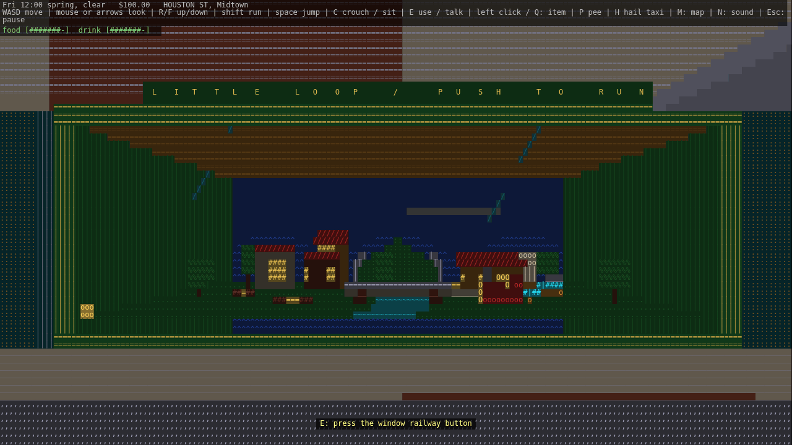
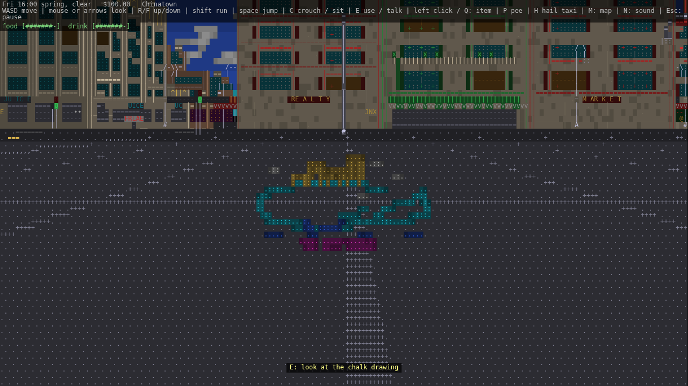
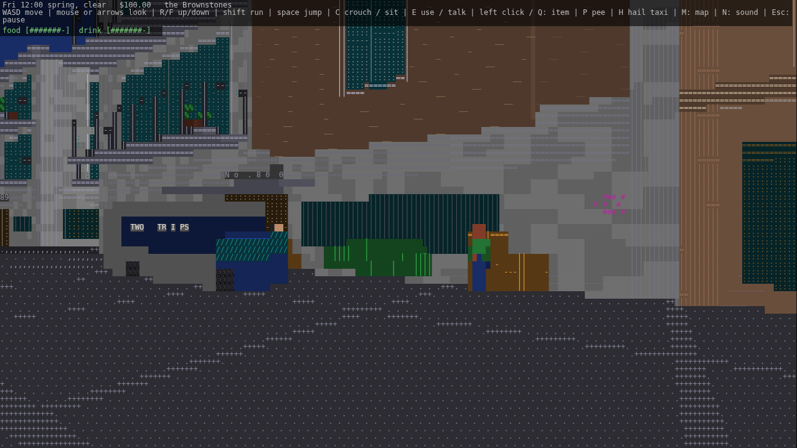
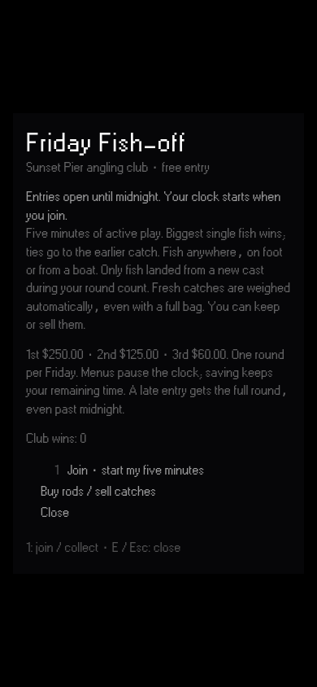
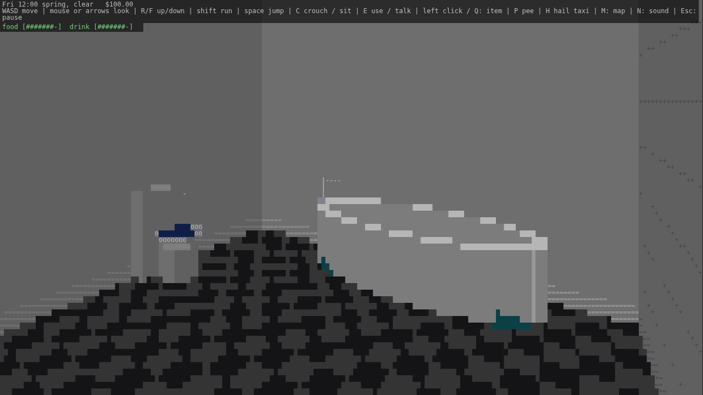
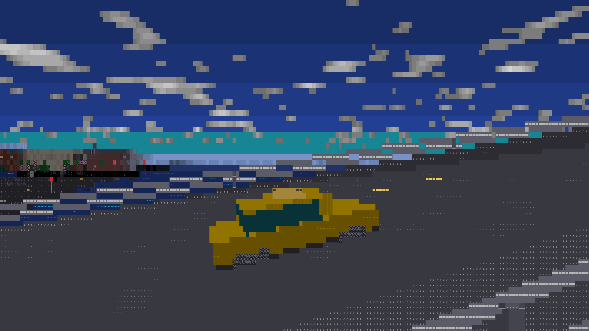

# Street stories

Find these in the map's **Things to do** list or search by name.

- **Little Loop window railway:** a working display in a TOYS shop window. The engine and two coaches stop at the station, cross the river and disappear through the hillside tunnel. Press the brass button for a demonstration, including after hours.
- **The pavement artist:** a fresh chalk picture starts at 9 and develops through the afternoon. Stand on the white footprints to see the whale carrying its golden city. Rain erases it for the day; snow covers the paving.
- **Moving day:** Friday, 9–17 on the game clock. Movers, boxes, an awkward sofa and a van parked clear of the traffic lane. After 17, a free amber lamp remains; it can be taken home and put on a display shelf.

The railway capture shows one complete 24-second cycle at **2× speed**, from the ordinary game camera.

## Friday Fish-off

Search **Friday Fish-off** on the map and visit Bait & Tackle at Sunset Pier. Bring a rod. During counter hours, choose the competition row (or press F); after hours, E at the hatch opens the notice directly.

Entry is free and open all Friday. Joining starts your own five-minute biggest-fish round against four local regulars, with $250 / $125 / $60 prizes. Menus pause the timer, saves retain it, and a late-Friday start continues past midnight. Fresh catches are weighed automatically, including fish released because your bag is full. Collect results at the hatch any time. One entry per Friday.

## Apartment and street fixes

Apartment shelves sit against the wall with a clear approach. Beds offer **E: sleep** from the bedside. Workshop furniture snaps flush to a nearby wall while keeping the entrance aisle open. Bathrooms have wall-backed toilets, pedestal basins and, in larger apartments, an open oval bath with a recessed bowl and tap.

Cars follow the road's pitch and cross slope, including the bridge approaches. Shotengai roof spans attach to opposing facades; missing buildings and coastal gaps stay open to the sky.

## Placement fixes

`ramen-clerks.png` shows the kitchen staff clear of the back wall, viewed from
the customer side of the counter. `bridge-approach.png` shows Iron Bridge
starting beyond the waterfront junction, leaving the cross street at ground level.
